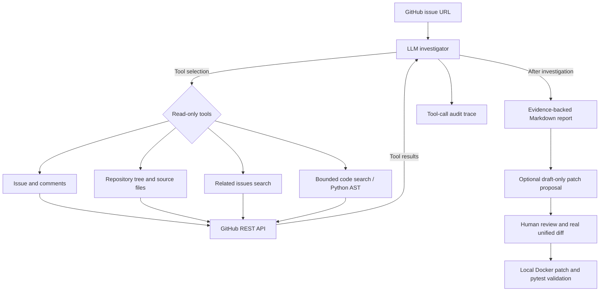

# IssuePilot — AI-Assisted GitHub Bug Investigation (V3 Sandbox MVP)

A small but genuine **agentic AI** project: an LLM can choose which **read-only GitHub API tools** to call, inspect an issue and related source context, and produce an evidence-backed investigation report. Unlike document Q&A / RAG, this demonstrates multi-step tool use and a bounded agent execution loop.

> **Scope:** MVP, not a production bug-fixing system. Reports contain hypotheses, not verified fixes. No GitHub write permissions or shell/code execution. Do not run on private employer repositories without authorization.

## Capabilities

- Uses the **OpenAI Responses API** with an actual multi-turn **function-calling loop** (not a hard-coded fetch → summarize chain).
- Seven read-only tools: `get_issue`, `get_issue_comments`, `list_repository_files`, `read_repository_file`, `find_related_issues`, `search_repository_code`, and `inspect_python_symbol`.
- Bounded repository text search with linked line-number evidence, plus Python AST symbol inspection for function definitions, base classes, and syntactic call sites. These are heuristics, **not a full semantic call graph**.
- Optional `--propose-patch` generates a separate, **unverified Markdown patch suggestion** after investigation. It never writes to the target GitHub repository or executes a patch.
- Restricts investigation to the requested repository; rejects path traversal and secret-like file paths.
- Adds budgets (6 exploratory model rounds, 12 tool calls), caches repeated tool requests, and forces a final synthesis with tools disabled when a budget is reached. Reports and safe tool-call audit JSON are saved locally.
- Automated offline tests for the GitHub API adapter, agent orchestration, safety controls, and budget handling; no API key needed for tests.

## Setup

Requires Python 3.10+.

```bash
python3 -m venv .venv
source .venv/bin/activate
pip install -e '.[dev]'
pytest -q
```

Automated tests use mocked external services to make CI deterministic and independent of credentials; V2 adds source-search, AST, and non-applying patch-proposal coverage. A separate manual end-to-end run has also been completed against the live OpenAI and GitHub APIs; see the evaluation notes below.

## Run on a public GitHub issue

Get an OpenAI API key with Responses API access. This **incurs API charges**; ChatGPT subscriptions are billed separately.

```bash
export OPENAI_API_KEY="..."  # configure in your shell only; never commit keys
# Optional: authenticated GitHub REST API limits (read-only permissions)
export GITHUB_TOKEN="..."
issuepilot "https://github.com/OWNER/REPO/issues/NUMBER"
```

Use a real, public **Issue** URL (not a pull request). The tool creates `investigation.md` and `tool-trace.json` locally. The trace includes a `status` field: `completed` or `budget_limited`. A budget-limited report is provisional and should not be treated as a verified fix. These outputs are ignored by Git to avoid accidentally publishing content. The trace contains tool names and arguments but no raw fetched code.

For an optional **draft-only** proposed fix and regression-test plan (incurs an additional model call):

```bash
issuepilot "https://github.com/pallets/itsdangerous/issues/429" --propose-patch
```

This creates `patch-proposal.md`, not a verified `.patch` or PR. Treat it as a design suggestion and manually review every detail. The system does not check whether a suggested diff applies or passes tests. **No repository files are modified.**

You may override the model:

```bash
issuepilot "https://github.com/OWNER/REPO/issues/NUMBER" --model gpt-5-mini
```

The default model, `gpt-5-mini`, supports Responses tool calling. GitHub unauthenticated rate limits may interrupt large investigations; `GITHUB_TOKEN` is optional. See [OpenAI function calling](https://developers.openai.com/api/docs/guides/function-calling) and [GitHub REST API](https://docs.github.com/en/rest).

## V3 Optional Local Sandbox Patch Validation

**Status:** Docker validation support is implemented, with automated offline tests. The first real Docker smoke test still needs to be performed on your Mac.

The validator is **separate from the LLM investigation**. It requires human review, an actual `git diff` patch, and explicit `--approve`. V2's `patch-proposal.md` is a Markdown suggestion, **not** an executable diff. This MVP does not automatically create a patch from the proposal.

```bash
# Build the local runner image (internet is used to install its dependencies at build time).
docker build -f sandbox/Dockerfile -t issuepilot-sandbox:v1 .

# Smoke test: an intentionally failing baseline and corrected Python test.
python -m issuepilot.sandbox \
  --repo-dir examples/sandbox_fixture \
  --patch examples/sandbox_fixture.patch \
  --approve \
  --output validation-report.json
```

If working correctly, `validation-report.json` reports `patched_tests_passed`, with the baseline results and patched results included. Runtime Docker restrictions include no network, non-root user, read-only input mounts, Linux capability dropping, limits on CPU/memory/PIDs, and ephemeral scratch storage. Docker is not a hardened isolation boundary for malicious code. **Only test trusted, reviewed source code; use a disposable VM for untrusted code.**

See [Sandbox setup, limitations, and manual validation](sandbox/README.md).

## V2 Source Intelligence

1. The agent reads the issue and chooses evidence-gathering tools dynamically.
2. `search_repository_code` ranks repository paths and searches **up to 18 allowed small source files**, returning line-number snippets and `partial_search` metadata. It searches only the first 14 KB of each returned file; an empty result does not prove a symbol is absent.
3. `inspect_python_symbol` uses `ast.parse` and `ast.unparse` on a permitted Python file (maximum 40 KB). It returns matching definitions, class bases, and syntactically observed calls, **without executing any source code**. It does not resolve dynamic dispatch, dependencies, or runtime behavior.
4. The agent produces a source-linked hypothesis report and an auditable tool trace. If its budget expires, it makes a final no-tools synthesis and marks the outcome `budget_limited`.
5. `--propose-patch` optionally asks for a conservative, unverified draft of changes and regression tests; it does **not** create a GitHub PR, apply changes, or run a sandbox.

## Architecture



## Design choices

- **One agent** rather than simulated multi-agent roles: one real tool loop is easier to verify.
- **No RAG dependency**: this is explicitly about live API tool use, not vector-based document retrieval.
- **Read-only GitHub tools**: the Agent cannot post comments, open PRs or edit remote issues. Patch suggestions are generated text files only. The **separate opt-in sandbox** executes reviewed local Python tests inside Docker; it never writes to a remote repository.
- **Evidence-aware**: links must come from tool results; the prompt tells the model to acknowledge uncertainty.
- **Safety tradeoffs**: repository content is untrusted and may contain prompt injection. Prompt instructions and path limits reduce risk, but this MVP does not guarantee full prompt-injection resistance. Use only public repositories and review outputs.

## End-to-end validation

A manual live run was completed on November 5, 2026 (US Pacific time), using the project's default OpenAI model and a public GitHub issue:

- **Test case:** [pallets/itsdangerous issue #429](https://github.com/pallets/itsdangerous/issues/429), about `URLSafeSerializer.loads` silently accepting an unexpected `max_age` parameter.
- **Observed execution:** The real API-backed CLI returned a structured Markdown investigation report, with GitHub source/issue links, after **6 tool calls**.
- **Outcome:** **Live integration exercised; investigation was `budget_limited`**, not a fully completed root-cause validation.
- **Human review:** The report identified the permissive `Serializer.loads(**kwargs)` signature, but its suggestion to forward `max_age` into `load_payload()` is **not a justified fix**. Inspecting [`timed.py`](https://github.com/pallets/itsdangerous/blob/main/src/itsdangerous/timed.py) shows expiry is checked by `TimestampSigner.unsign(max_age=...)` in the timed serializer path, rather than by payload decoding. The untimed serializer should instead reject or explicitly handle unsupported arguments; the appropriate compatibility-preserving design requires further review.
- **Evaluation caveat:** Live execution validates the model/API/tool integration and report generation, **not the correctness of every recommendation**. No tests or patch were run against the target repo.

### Next evaluation milestones

- [x] Run one real public issue with the OpenAI API and GitHub API.
- [x] Inspect the resulting report and identify a substantive unsupported recommendation.
- [ ] Run at least two further issues across another public repository.
- [ ] Review `tool-trace.json` for exact call sequence, failures, and token usage; record latency.
- [ ] Compare against a one-shot issue summarization baseline and score evidence grounding and proposed fixes.

**Do not put a made-up accuracy number or claim production deployment in a resume.**

## Suggested resume bullet (after live validation)

> Developed an AI-assisted GitHub bug investigation agent using Python and OpenAI function calling, featuring bounded code search, AST symbol inspection, and source-linked diagnoses; added a manually approved local Docker patch-validation workflow with pytest and structured test results.

## Development

```bash
pytest -q
```

The repository includes a GitHub Actions workflow that executes the offline test suite on push and pull requests. The exploratory loop has an explicit termination mechanism: when it reaches the round or tool budget, one final OpenAI request with `tool_choice="none"` synthesizes the evidence. A live model run requires an OpenAI API key, GitHub API connectivity, and separate API billing; it has **not** been validated in CI.

Never paste a GitHub token or OpenAI key into a chat or commit it into Git.