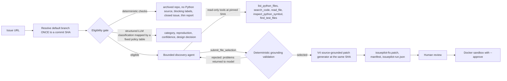
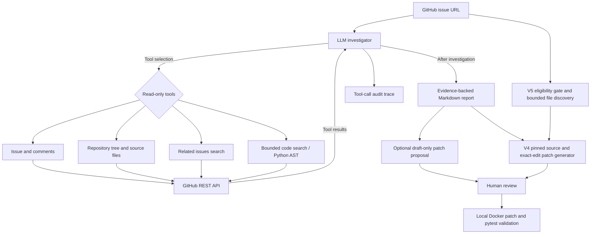

# IssuePilot — AI-Assisted GitHub Bug Investigation (V5 URL-only Draft Fixes)

A small but genuine **agentic AI** project: an LLM can choose which **read-only GitHub API tools** to call, inspect an issue and related source context, and produce an evidence-backed investigation report. Unlike document Q&A / RAG, this demonstrates multi-step tool use and a bounded agent execution loop.

> **Scope:** MVP, not a production bug-fixing system. Reports contain hypotheses, not verified fixes. No GitHub write operations; reviewed local tests run only via the separate opt-in Docker sandbox. Do not run on private employer repositories without authorization.

## Capabilities

- Uses the **OpenAI Responses API** with an actual multi-turn **function-calling loop** (not a hard-coded fetch → summarize chain).
- Seven read-only tools: `get_issue`, `get_issue_comments`, `list_repository_files`, `read_repository_file`, `find_related_issues`, `search_repository_code`, and `inspect_python_symbol`.
- Bounded repository text search with linked line-number evidence, plus Python AST symbol inspection for function definitions, base classes, and syntactic call sites. These are heuristics, **not a full semantic call graph**.
- Optional `--propose-patch` generates a separate, **unverified Markdown patch suggestion** after investigation. It never writes to the target GitHub repository or executes a patch.
- Restricts investigation to the requested repository; rejects path traversal and secret-like file paths.
- Adds budgets (6 exploratory model rounds, 12 tool calls), caches repeated tool requests, and forces a final synthesis with tools disabled when a budget is reached. Reports and safe tool-call audit JSON are saved locally.
- **V5:** from only an issue URL, an eligibility gate and a bounded file-discovery agent choose the source and test files for the source-grounded patch generator, with every stage pinned to one commit and explicit `unsupported` / `needs_review` outcomes.
- Automated offline tests for the GitHub API adapter, agent orchestration, safety controls, and budget handling; no API key needed for tests.

## Setup

Requires Python 3.10+.

```bash
python3 -m venv .venv
source .venv/bin/activate
pip install -e '.[dev]'
pytest -q
```

Automated tests use mocked external services to make CI deterministic and independent of credentials; V2 adds source-search, AST, and non-applying patch-proposal coverage. A separate manual end-to-end run has also been completed against the live OpenAI and GitHub APIs; see the evaluation notes below.

## Run on a public GitHub issue

Get an OpenAI API key with Responses API access. This **incurs API charges**; ChatGPT subscriptions are billed separately.

```bash
export OPENAI_API_KEY="..."  # configure in your shell only; never commit keys
# Optional: authenticated GitHub REST API limits (read-only permissions)
export GITHUB_TOKEN="..."
issuepilot "https://github.com/OWNER/REPO/issues/NUMBER"
```

Use a real, public **Issue** URL (not a pull request). The tool creates `investigation.md` and `tool-trace.json` locally. The trace includes a `status` field: `completed` or `budget_limited`. A budget-limited report is provisional and should not be treated as a verified fix. These outputs are ignored by Git to avoid accidentally publishing content. The trace contains tool names and arguments but no raw fetched code.

For an optional **draft-only** proposed fix and regression-test plan (incurs an additional model call):

```bash
issuepilot "https://github.com/pallets/itsdangerous/issues/429" --propose-patch
```

This creates `patch-proposal.md`, not a verified `.patch` or PR. Treat it as a design suggestion and manually review every detail. The system does not check whether a suggested diff applies or passes tests. **No repository files are modified.**

You may override the model:

```bash
issuepilot "https://github.com/OWNER/REPO/issues/NUMBER" --model gpt-5-mini
```

The default model, `gpt-5-mini`, supports Responses tool calling. GitHub unauthenticated rate limits may interrupt large investigations; `GITHUB_TOKEN` is optional. See [OpenAI function calling](https://developers.openai.com/api/docs/guides/function-calling) and [GitHub REST API](https://docs.github.com/en/rest).

## V5 URL-only Draft Fixes (automatic eligibility + file discovery)

**Status:** Implemented with deterministic offline tests on synthetic projects and a scripted model, plus **one** live end-to-end run on a real issue (below). One run is a case study, not a success rate; no general discovery accuracy or repair rate is claimed.

```bash
python -m issuepilot.patch_generator "https://github.com/OWNER/REPO/issues/NUMBER"
# or, after `pip install -e .`
issuepilot-fix "https://github.com/OWNER/REPO/issues/NUMBER"
```

Passing `--files` keeps the V4 manual behaviour exactly; omitting it runs:



**Eligibility gate** (`issuepilot/eligibility.py`). Deterministic checks run first and cannot be overridden by the model: archived repository, no non-test Python source at the pinned commit, generic blocking labels (`enhancement`, `documentation`, `question`, ...), conflicting labels, non-Python primary language, a closed issue without an explicit `--revision`, or a too-short report. Only then is the model asked for a strict-JSON classification (category, reproduction present, expected-vs-actual, design decision needed, confidence). Code maps those fields to a status through a fixed policy table; malformed output fails closed to `needs_review`. Identifiers the classifier reports are kept as discovery hints only if they literally appear in the issue text.

**Discovery agent** (`issuepilot/discovery.py`). An OpenAI Responses tool loop (`tool_choice="required"`, no parallel calls) with five read-only tools bound to the pinned SHA. It ends only through `submit_file_selection`, whose arguments are validated against an evidence ledger of what the tools actually returned:

- every path exists in the pinned tree and is a permitted `.py` file within the patch generator's size limits;
- every selected **source** file was read (`read_file` or a matching `inspect_python_symbol`) and is library code (not tests, docs, examples, `setup.py` or vendored code);
- every selected **test** file surfaced in `find_test_files`, `search_code` or `read_file`;
- evidence citations reference only paths returned by tools.

Rejected submissions go back to the model with concrete problems (max 3 attempts). Budgets: 10 model rounds, 14 exploration calls (`--max-tool-calls`), 40 file fetches. When the exploration budget is spent the model gets one final round in which **only** the submit tool is offered; if that does not produce a valid selection, the run ends as `needs_review` with deterministically ranked provisional candidates. A low-confidence selection is never patched automatically.

**Outcomes and exit codes.** `issuepilot-run.json` is written for every outcome (decisions, tool names/arguments, per-stage token usage; no fetched source text).

| Status | Exit | Meaning |
| --- | --- | --- |
| `draft_ready` | 0 | Unverified diff and manifest written |
| `eligible` / `files_selected` | 0 | Stopped early via `--stop-after eligibility` or `--stop-after discovery` |
| `unsupported` | 3 | Out of scope (not a Python library logic bug, or code outside Python source) |
| `needs_review` | 4 | Ambiguous, low confidence, budget exhausted, or invalid selections |
| `patch_failed` | 5 | Generator refused: fabricated/ambiguous anchors, syntax error, empty or test-only edits |
| `error` | 1 | GitHub/API failure |

`--accept-needs-review` lets a human continue past an eligibility `needs_review` (never past `unsupported`); the run record marks it as `human_override: true`. `--revision SHA` pins every stage to an explicit commit (for example the parent of a known fix, for evaluation against closed issues). The manifest keeps `schema_version: 1`, so the existing sandbox provenance check works unchanged.

**What the tests cover.** `tests/synthetic_github.py` serves several synthetic projects (src layout, flat layout with nested tests, a C++-backed extension, a JavaScript repo, a mixed-language repo) through a fake GitHub REST API with commit-addressable trees. Scripted model replies drive unsupported and needs-review paths, wrong file selections, tool- and round-budget exhaustion, GitHub failures, unsafe tool arguments, generator failures, branch movement mid-run, and the CLI. Two end-to-end tests apply the generated diff to a local copy of a synthetic project and show its regression test failing before and passing after the source change. These validate the pipeline mechanics when the model proposes the right edit; they are **not** evidence of live model quality.

### Live run 1: pallets/itsdangerous #429 (gpt-5-mini, 2026-11-06)

Issue: `URLSafeSerializer.loads(token, max_age=...)` silently ignores `max_age`, so a caller who picked the wrong serializer believes tokens expire when they do not. Pinned commit `672971d66a2ef9f85151e53283113f33d642dabd`.

| Stage | What happened |
| --- | --- |
| Eligibility | `needs_review` in both runs, for different stated reasons (`requires_design_decision`, then `security_sensitive`). The fixed policy table kept the outcome stable while the model's wording varied. Continued with `--accept-needs-review` (recorded as `human_override: true`). |
| Discovery | 7 of 14 exploration calls, first submission accepted. Selected `src/itsdangerous/serializer.py` (base `Serializer.loads` takes `**kwargs` and ignores them; `URLSafeSerializer` inherits it) and `tests/test_itsdangerous/test_url_safe.py`. ~59K input tokens. |
| Comparison | The earlier manual V4 run used `serializer.py`, `timed.py`, `test_serializer.py`. Discovery agreed on the source file and did not need `timed.py`. |
| Patch | `Serializer.loads` raises `TypeError` for unexpected keyword arguments; a regression test was added to `TestURLSafeSerializer`. |
| Docker validation | Baseline 297 passed. Patched: 298 passed, **1 failed** (`patched_tests_failed`). |

**Why it failed:** `TestURLSafeTimedSerializer` inherits from `TestURLSafeSerializer`, so the new test also ran against the timed serializer, which legitimately accepts `max_age`; `max_age=-1` raised `SignatureExpired` instead of `TypeError`. The source change broke none of the 297 existing tests, but the model-written regression test was placed in an inherited test class. The sandbox caught this; the draft was not treated as a fix.

**Human-corrected follow-up:** [`examples/itsdangerous-429-corrected.patch`](examples/itsdangerous-429-corrected.patch) keeps the model's source change unchanged and only moves the regression test to a module-level function, so the timed test classes no longer inherit it. Checked locally at the pinned commit: the new test fails on the original source (`DID NOT RAISE TypeError`) and passes with the fix; timed serializers still accept `max_age`. Docker validation of this corrected patch (no manifest, since the patch hash changed): baseline 297 passed, patched suite passed (`patched_tests_passed`). This correction was made by a human, not by IssuePilot.

**Not yet shown:** whether maintainers would accept raising on unexpected keyword arguments (a compatibility decision).

## V4 Source-grounded Patch Generation (real `git diff`)

**Status:** This feature is implemented with offline tests. Running it against a real GitHub issue still requires your own live OpenAI API call and human review; no verified real-world fix is claimed.

Unlike the earlier Markdown-only `patch-proposal.md`, this separate CLI fetches the **full text** of selected Python source and test files at a **single immutable GitHub commit**, asks the model for exact anchored replacements, refuses fabricated/ambiguous source snippets, checks Python syntax, and deterministically renders an actual **unified Git diff**. It also generates a SHA-256 manifest to verify the exact local checkout and patch before Docker execution.

```bash
python -m issuepilot.patch_generator \
  "https://github.com/pallets/itsdangerous/issues/429" \
  --files src/itsdangerous/serializer.py src/itsdangerous/timed.py tests/test_itsdangerous/test_serializer.py \
  --investigation investigation.md
```

Outputs are `issuepilot-fix.patch` (a genuine draft diff) and `issuepilot-patch-manifest.json` (pinned revision and hashes). **This is still an unverified LLM proposal** and may be rejected if the model uses non-existent text. Failure to generate a diff is safer than inventing one. The tool never runs or applies the diff; it doesn't write to GitHub.

Clone the *public target project* separately and check out the **exact commit printed by the generator**:

```bash
git clone https://github.com/pallets/itsdangerous.git ../itsdangerous
cd ../itsdangerous
git checkout YOUR_PRINTED_40_CHARACTER_COMMIT_SHA
cd ../issuepilot-agent

# Only after reading and approving issuepilot-fix.patch:
python -m issuepilot.sandbox \
  --repo-dir ../itsdangerous \
  --patch issuepilot-fix.patch \
  --manifest issuepilot-patch-manifest.json \
  --approve \
  --output validation-report.json
```

Docker checks the pinned SHA-256 source contents and patch hash *before* execution. It reports baseline and patched tests separately. A passing run does **not** prove the bug is fixed, unless a relevant regression test demonstrably fails before and passes after. Existing tests alone are not sufficient; model-generated regression tests also require review. Never automatically run arbitrary code from unknown repositories; use a disposable VM for malicious/untrusted code.

## V3 Optional Local Sandbox Patch Validation

**Status:** Docker validation support is implemented, with offline tests. A manual Docker fixture smoke test ran successfully on a Mac: the baseline had 1 failing test, and the patched version passed all 3. This establishes the sample workflow, not the correctness of an AI-produced real bug fix.

The validator is **separate from the LLM investigation**. It requires human review, an actual `git diff` patch, and explicit `--approve`. V2's `patch-proposal.md` is a Markdown suggestion, **not** an executable diff. The new V4 `issuepilot.patch_generator` separately creates a real diff from exact GitHub sources, but only from explicitly selected files and with a manual approval boundary.

```bash
# Build the local runner image (internet is used to install its dependencies at build time).
docker build -f sandbox/Dockerfile -t issuepilot-sandbox:v1 .

# Smoke test: an intentionally failing baseline and corrected Python test.
python -m issuepilot.sandbox \
  --repo-dir examples/sandbox_fixture \
  --patch examples/sandbox_fixture.patch \
  --approve \
  --output validation-report.json
```

If working correctly, `validation-report.json` reports `patched_tests_passed`, with the baseline results and patched results included. Runtime Docker restrictions include no network, non-root user, read-only input mounts, Linux capability dropping, limits on CPU/memory/PIDs, and ephemeral scratch storage. Docker is not a hardened isolation boundary for malicious code. **Only test trusted, reviewed source code; use a disposable VM for untrusted code.**

See [Sandbox setup, limitations, and manual validation](sandbox/README.md).

## V2 Source Intelligence

1. The agent reads the issue and chooses evidence-gathering tools dynamically.
2. `search_repository_code` ranks repository paths and searches **up to 18 allowed small source files**, returning line-number snippets and `partial_search` metadata. It searches only the first 14 KB of each returned file; an empty result does not prove a symbol is absent.
3. `inspect_python_symbol` uses `ast.parse` and `ast.unparse` on a permitted Python file (maximum 40 KB). It returns matching definitions, class bases, and syntactically observed calls, **without executing any source code**. It does not resolve dynamic dispatch, dependencies, or runtime behavior.
4. The agent produces a source-linked hypothesis report and an auditable tool trace. If its budget expires, it makes a final no-tools synthesis and marks the outcome `budget_limited`.
5. `--propose-patch` optionally asks for a conservative, unverified draft of changes and regression tests; it does **not** create a GitHub PR, apply changes, or run a sandbox.

## Architecture



## Design choices

- **One agent** rather than simulated multi-agent roles: one real tool loop is easier to verify.
- **No RAG dependency**: this is explicitly about live API tool use, not vector-based document retrieval.
- **Read-only GitHub tools**: the Agent cannot post comments, open PRs or edit remote issues. Patch suggestions are generated text files only. The **separate opt-in sandbox** executes reviewed local Python tests inside Docker; it never writes to a remote repository.
- **Evidence-aware**: links must come from tool results; the prompt tells the model to acknowledge uncertainty.
- **Safety tradeoffs**: repository content is untrusted and may contain prompt injection. Prompt instructions and path limits reduce risk, but this MVP does not guarantee full prompt-injection resistance. Use only public repositories and review outputs.

## End-to-end validation

A manual live run was completed on November 5, 2026 (US Pacific time), using the project's default OpenAI model and a public GitHub issue:

- **Test case:** [pallets/itsdangerous issue #429](https://github.com/pallets/itsdangerous/issues/429), about `URLSafeSerializer.loads` silently accepting an unexpected `max_age` parameter.
- **Observed execution:** The real API-backed CLI returned a structured Markdown investigation report, with GitHub source/issue links, after **6 tool calls**.
- **Outcome:** **Live integration exercised; investigation was `budget_limited`**, not a fully completed root-cause validation.
- **Human review:** The report identified the permissive `Serializer.loads(**kwargs)` signature, but its suggestion to forward `max_age` into `load_payload()` is **not a justified fix**. Inspecting [`timed.py`](https://github.com/pallets/itsdangerous/blob/main/src/itsdangerous/timed.py) shows expiry is checked by `TimestampSigner.unsign(max_age=...)` in the timed serializer path, rather than by payload decoding. The untimed serializer should instead reject or explicitly handle unsupported arguments; the appropriate compatibility-preserving design requires further review.
- **Evaluation caveat:** Live execution validates the model/API/tool integration and report generation, **not the correctness of every recommendation**. No tests or patch were run against the target repo.

### Next evaluation milestones

- [x] Run one real public issue with the OpenAI API and GitHub API.
- [x] Inspect the resulting report and identify a substantive unsupported recommendation.
- [ ] Generate a real source-grounded patch for issue #429 and manually verify its claims.
- [ ] Run source-pinned Docker validation on that reviewed patch with a regression test.
- [ ] Run at least two further issues across another public repository.
- [x] Run the V5 URL-only pipeline live end to end on one real issue with Docker validation (itsdangerous #429: correct source file, regression test misplaced; see above).
- [x] Run the pre-registered [mini benchmark](benchmark/README.md) (8 fixed issues, 4 repositories): discovery recall 6/6, 3/6 bug cases Docker-validated with source changes that also pass upstream's regression tests, 2 generator failures (fail-closed), 1 infrastructure, 1 eligibility miss.
- [x] Run a pre-registered holdout set (13 cases, 6 new repositories) and an LLM-only localization baseline. Combined with the dev set: 12/12 root-cause files located, 5 Docker-validated fixes that all pass upstream regression tests; the baseline matched localization on these small repos (see [benchmark](benchmark/README.md)).
- [ ] Evaluate localization on larger repositories where a single prompt cannot see the right file; relax sandbox staging for binary test fixtures.
- [ ] Run the V5 URL-only pipeline live on several more public issues (including closed issues pinned with `--revision` to the commit before their fix); record eligibility decisions, selected files versus the files the real fix touched, and failure reasons.
- [ ] Review `tool-trace.json` for exact call sequence, failures, and token usage; record latency.
- [ ] Compare against a one-shot issue summarization baseline and score evidence grounding and proposed fixes.

**Do not put a made-up accuracy number or claim production deployment in a resume.**

## Suggested resume bullet (after live validation)

> Developed an AI-assisted GitHub bug investigation agent using Python and OpenAI function calling, featuring bounded code search, AST symbol inspection, and source-linked diagnoses; added a manually approved local Docker patch-validation workflow with pytest and structured test results.

What V5 adds, in wording that matches what is currently tested (offline only):

> Built a URL-only pipeline that gates GitHub issues for eligibility and runs a bounded tool-calling agent to locate source and test files at a pinned commit, validating its structured selections against tool evidence before source-grounded diff generation; covered with deterministic tests across synthetic multi-project fixtures.

## Development

```bash
pytest -q
```

The repository includes a GitHub Actions workflow that executes the offline test suite on push and pull requests. The exploratory loop has an explicit termination mechanism: when it reaches the round or tool budget, one final OpenAI request with `tool_choice="none"` synthesizes the evidence. A live model run requires an OpenAI API key, GitHub API connectivity, and separate API billing; it has **not** been validated in CI.

Never paste a GitHub token or OpenAI key into a chat or commit it into Git.